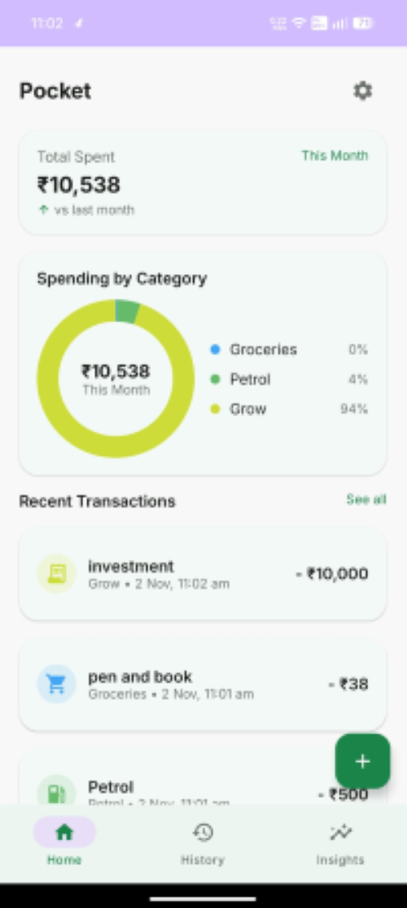
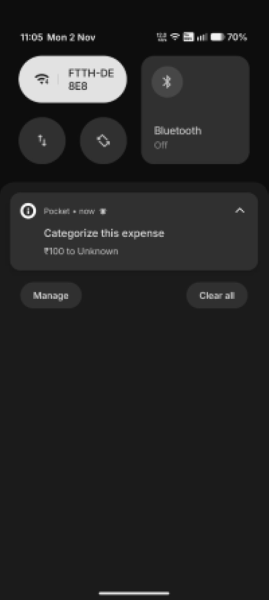
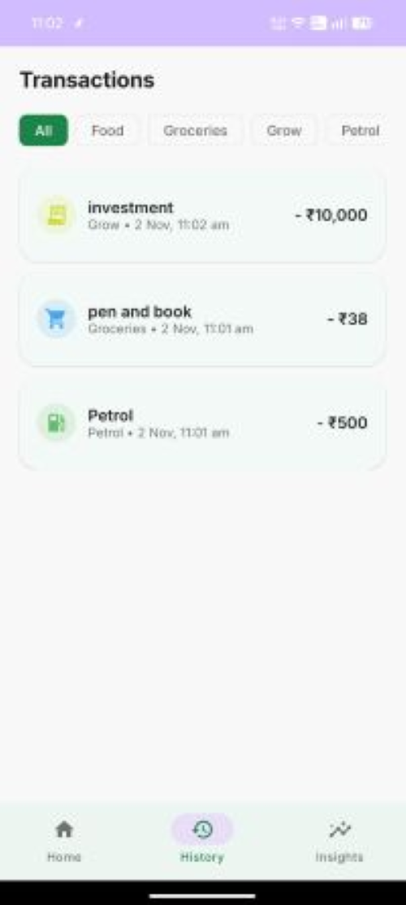
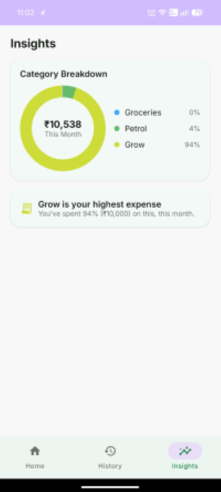

# Pocket: Expense Tracker

An Android expense tracker built with Kotlin and Jetpack Compose. Pocket listens for outgoing Google Pay payment notifications, asks the user to categorize each payment through a lock-screen popup, and stores every transaction locally to power a spending dashboard.

## Overview

Manual expense tracking fails because logging a payment is a separate step that is easy to forget. Pocket removes that step: when a payment notification arrives, a popup appears immediately and the user records the category in a single tap. All data stays on the device.

## Features

- **Notification-based capture:** a `NotificationListenerService` detects Google Pay payment notifications and extracts the amount and payee.
- **Category popup:** a transparent, full-screen activity (shown over the lock screen) lets the user pick a category, followed by a save confirmation card.
- **Home dashboard:** total spent this month, a category-wise donut chart, and recent transactions.
- **History:** the full transaction list with category filters.
- **Insights:** category breakdown and top-spending-category summary.
- **Local storage:** all transactions are stored in a Room (SQLite) database. No account, backend or cloud sync.

## How It Works

1. A Google Pay payment notification is posted to the device.
2. `PaymentNotificationListener` filters for the Google Pay package, checks the wording, and parses the amount and payee.
3. `CategoryPopupActivity` opens over the current screen and prompts for a category (Food, Groceries, Petrol, Travel, Shopping, Others).
4. The transaction is saved through `TransactionRepository` into the Room database.
5. `TransactionViewModel` exposes the data as `StateFlow`s, and the Compose screens update reactively.

## Architecture

The app follows an MVVM structure with a single local data source.

```
com.rohith.pocket
├── MainActivity, PocketApplication
├── data/          Room entity, DAO, database, repository, Category enum
├── viewmodel/     TransactionViewModel (StateFlow for lists and totals)
├── notification/  PaymentNotificationListener
├── navigation/    Compose navigation (Home, History, Insights, Monthly, Settings)
└── ui/            screens, reusable components (donut chart), Material 3 theme
```

## Tech Stack

| Area | Technology |
|---|---|
| Language | Kotlin 1.9.24 |
| UI | Jetpack Compose, Material 3 (Compose BOM 2024.06.00) |
| Navigation | Navigation Compose 2.7.7 |
| Persistence | Room 2.6.1 (KSP) |
| Async | Kotlin Coroutines and Flow |
| Lifecycle | ViewModel, Lifecycle 2.8.4 |
| Build | Android Gradle Plugin 8.4.2, compileSdk and targetSdk 34, minSdk 26, JVM 17 |

## Permissions

| Permission | Purpose |
|---|---|
| `BIND_NOTIFICATION_LISTENER_SERVICE` | Required for the app to act as a notification listener (granted by the user in system settings) |
| `POST_NOTIFICATIONS` | Posting the app's own notifications |
| `USE_FULL_SCREEN_INTENT` | Showing the category popup over the lock screen |

The app requests no SMS, contacts, storage or network permissions.

## Getting Started

**Requirements:** Android Studio, Android SDK 34, JDK 17, and a device or emulator running Android 8.0 (API 26) or higher.

1. Clone the repository and open the `PocketApp` folder in Android Studio.
2. Allow Gradle to sync and download dependencies.
3. Run the app on a device or emulator.
4. Open **Settings → Notification access** on the device and enable access for Pocket.
5. Make a Google Pay payment. The category popup appears when the notification is received.

This repository does not include the Gradle wrapper, so it should be built from Android Studio.

## Known Limitations

- Capture depends on Google Pay's notification wording and on whether the device posts a notification for outgoing payments. This varies by device and app version.
- The Monthly screen currently shows placeholder bars and is not yet connected to real data.
- The "vs last month" comparison on the Home screen is not yet calculated.
- Saved transactions cannot yet be edited or deleted.
- Entries in Settings (Categories, Data and Backup, Appearance, About) are static placeholders.

## Planned Improvements

- Manual expense entry for payments that are not captured automatically
- Editable and custom categories
- Edit and delete for saved transactions
- Real monthly comparison data on the Monthly and Home screens
- Data export and backup

.


|## Screenshots

| Home | Category Popup | History | Insights |
|---|---|---|---|
|  |  |  |  |

## Author

**Rohith Sajeev**
Final-year Electrical and Electronics Engineering student, Vimal Jyothi Engineering College, Kannur
[LinkedIn](https://linkedin.com/in/rohith-sajeev-5167793a4) · rohithsajeev1010@gmail.com
